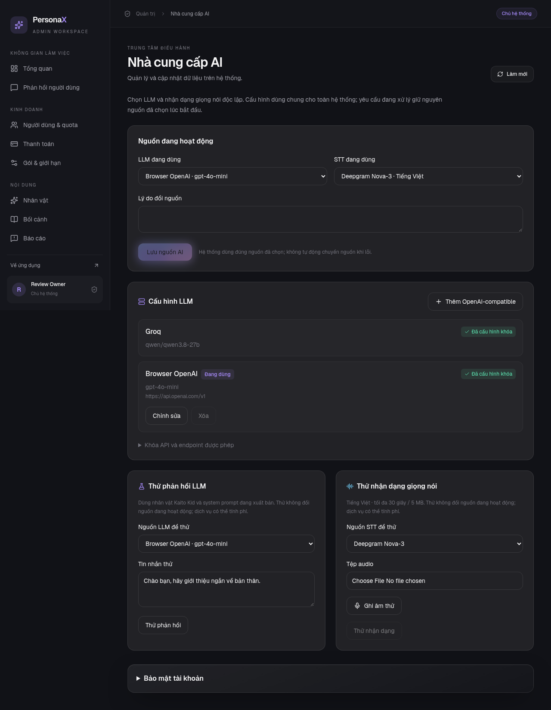
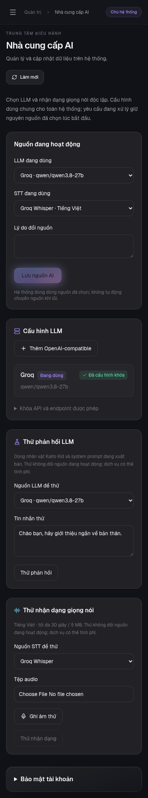

# Nhà cung cấp AI

Mở **Quản trị → AI & vận hành → Nhà cung cấp AI** (`/admin?tab=providers`).
Admin/owner chọn LLM và STT độc lập; production yêu cầu phiên đã xác minh MFA.
Moderator không được truy cập.

- LLM: Groq mặc định hoặc tối đa 50 cấu hình OpenAI-compatible.
- STT: Groq Whisper hoặc Deepgram Nova-3 (`language=vi`, `smart_format=true`).
- TTS: Gemini tiếp tục đọc các đoạn dialogue đã được kiểm tra.

Chạy `cd backend && uv run --locked python -m alembic upgrade head` trước triển
khai. Migration `c1d82e4f630a` tạo `ai_settings` và `llm_profiles`, giữ Groq mặc định.
Seed không ghi đè lựa chọn đã lưu. Mỗi yêu cầu chốt nguồn, model, khóa và giá trước
khi gọi dịch vụ; thay đổi chỉ ảnh hưởng yêu cầu mới. Không tự đổi nguồn khi lỗi.
Không cho xóa cấu hình LLM đang hoạt động.

## Khóa và endpoint

Khóa nằm ở backend; database, API quản trị và audit không lưu giá trị khóa.
Giao diện chỉ dùng tên tham chiếu và trạng thái cấu hình. Trong `.env.backend`
(Compose) hoặc `backend/.env` (local), cấu hình:

```dotenv
DEEPGRAM_API_KEY=<deepgram-key>
LLM_API_KEYS_JSON='{"openai":"<openai-key>","router":"<openrouter-key>"}'
LLM_ALLOWED_HOSTS=api.openai.com,openrouter.ai,api.groq.com
```

Restart backend khi thay khóa/allowlist. Sau đó admin thêm, sửa, thử và chọn các
profile mà không cần restart tiếp. Tên khóa `groq` tham chiếu `GROQ_API_KEY`.
Groq mặc định vẫn dùng `GROQ_LLM_MODEL` và `GROQ_STT_MODEL` như trước.

Endpoint tùy chỉnh phải dùng HTTPS cổng 443, hostname nằm trong allowlist, không
chứa thông tin đăng nhập, query, fragment hoặc IP literal. Backend kiểm tra DNS
khi lưu/kích hoạt và khi gọi; chặn mọi kết quả phân giải không công khai, ghim IP
đã kiểm tra, giữ Host/TLS SNI gốc, không theo redirect. Client này không đi qua
proxy từ biến môi trường để tránh proxy phân giải lại hostname sau kiểm tra.
Backend cần đường HTTPS outbound trực tiếp tới provider tương ứng.

Không đặt khóa vào `NEXT_PUBLIC_*`, base URL, form quản trị hoặc Git. Có thể lưu
profile dùng tên khóa đã đăng ký nhưng còn trống; không thể kích hoạt nguồn mới
thiếu khóa. Tên khóa chưa đăng ký bị từ chối.

## Cấu hình LLM

| Trường | OpenAI | OpenRouter |
| --- | --- | --- |
| Base URL | `https://api.openai.com/v1` | `https://openrouter.ai/api/v1` |
| Model | Model được phép trong tài khoản, ví dụ `gpt-4o-mini` | Model được phép trong tài khoản, ví dụ `openai/gpt-4o-mini` |
| Tên khóa | `openai` | `router` |

Backend nối `/chat/completions` vào base URL. Adapter dùng Chat Completions không
stream token upstream; SSE của ứng dụng giữ nguyên hợp đồng các event theo segment.
Model chỉ hỗ trợ Responses API nằm ngoài phạm vi adapter này.

Chọn theo khả năng model:

- `json_object`, JSON Schema strict, hoặc JSON theo prompt. Mọi kết quả đều phải
  vượt qua kiểm tra schema lời dẫn/lời thoại và vocal tags trước khi lưu hoặc đọc.
- `max_tokens` hoặc `max_completion_tokens` cho giới hạn đầu ra.
- Temperature/reasoning effort để trống nghĩa là không gửi tham số đó.
- Bộ đếm token: `o200k_base` cho GPT-4o/o-series; `cl100k_base` cho GPT-4/3.5;
  Qwen cho model Qwen; UTF-8 là ước lượng bảo thủ khi không có tokenizer phù hợp.

Vocabulary Qwen/OpenAI được đóng gói sẵn; không tải mạng ở runtime. Hai file
OpenAI được kiểm tra SHA-256 chính thức, tương ứng tiktoken 0.14.0. Dữ liệu BPE
được lấy qua gói MIT js-tiktoken 1.0.21 rồi tái tạo và đối chiếu đúng hash từ
OpenAI tiktoken; regex và special tokens dùng định nghĩa chính thức của tiktoken.
Xem [TIKTOKEN-LICENSE.txt](../../backend/app/seed/TIKTOKEN-LICENSE.txt).
Framing có thể khác giữa các provider; số token dịch vụ báo là nguồn đối chiếu hóa đơn.

## Giá và usage

Giá USD / một triệu token vào và ra là giá tham chiếu do admin khai báo. Để trống
cả hai nếu chưa biết; 0 nghĩa là admin xác nhận giá 0, không phải chưa biết.
Usage lưu provider, profile, model, token và giá tại thời điểm xử lý. Đổi giá
profile không tính lại lịch sử. Dashboard hiển thị tổng chi phí đã biết và số
lượt LLM hoàn tất chưa định giá; dữ liệu cũ dùng giá Qwen tham chiếu và được ghi
chú riêng. Ước tính chưa gồm STT/TTS và có thể chưa gồm các lần thử thất bại phía
provider; cần đối chiếu hóa đơn thực tế.

## Thử nguồn

- Thử LLM dùng Kaito Kid và system prompt đang xuất bản; hiển thị kết quả sau khi
  kiểm tra schema. Thử STT bằng ghi âm hoặc tải tệp tối đa 30 giây / 5 MB.
- Audio được giải mã WAV mono 16 kHz; thời lượng dựa vào mẫu đã giải mã.
- Mỗi admin tối đa 5 lần thử/phút, một lần thử đang chạy. Phép thử vẫn gọi dịch vụ
  thật khi demo local bật, không thay nguồn và không trừ quota cá nhân. Provider
  có thể tính phí; usage/audit phép thử vẫn được lưu.
- Lỗi/hủy giải phóng reservation. Nội dung tin nhắn thử, transcript, khóa và lỗi
  thô của provider không được chép vào audit.

## AWS ECS

`AIProviderSecretArn` mặc định trống, nên deployment cũ không phải thêm key mới
vào secret cũ. Nếu bật nguồn mới, tạo secret riêng chứa toàn bộ JSON object:

```json
{
  "deepgram_api_key": "<deepgram-key>",
  "llm_api_keys": {"openai": "<openai-key>", "router": "<openrouter-key>"},
  "llm_allowed_hosts": ["api.openai.com", "openrouter.ai", "api.groq.com"]
}
```

Đưa ARN vào `AIProviderSecretArn`. Stack cấp execution role quyền đọc đúng ARN,
đưa toàn bộ secret vào `AI_PROVIDER_CONFIG_JSON` của backend/migration task.
`DEEPGRAM_API_KEY`, `LLM_API_KEYS_JSON`, `LLM_ALLOWED_HOSTS` nếu có sẽ ưu tiên hơn
JSON chung. Dùng AWS-managed KMS key hoặc cùng CMK với backend secret; nếu khác,
cần cấp quyền decrypt tương ứng. Frontend không nhận secret. Rotation cần restart task.

## Kiểm thử và ảnh minh họa

Backend tests dùng HTTP mock: auth/payload STT, JSON modes, tokenizer, quota, lỗi,
rate limit, timeout, đổi nguồn khi đang xử lý, giá lịch sử, DNS pinning, MFA/CSRF
và pipeline Nova-3 → LLM-compatible → Gemini TTS. Browser tests đi qua API thật
của test harness; provider và DNS ngoài được mock. Muốn xác minh chất lượng,
chi phí/độ trễ thực tế, cấu hình khóa thật rồi dùng các nút thử.

Ảnh dưới đây dùng dữ liệu kiểm thử:




