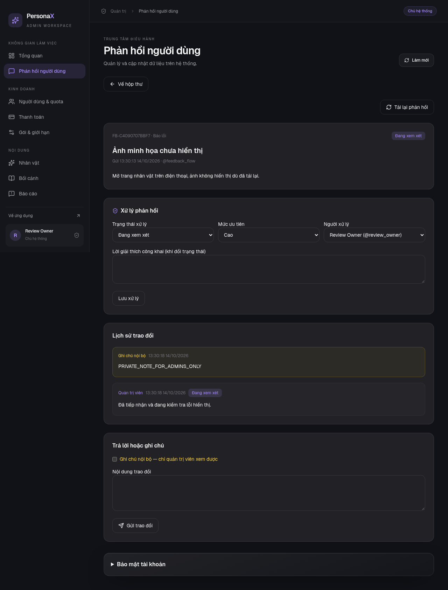
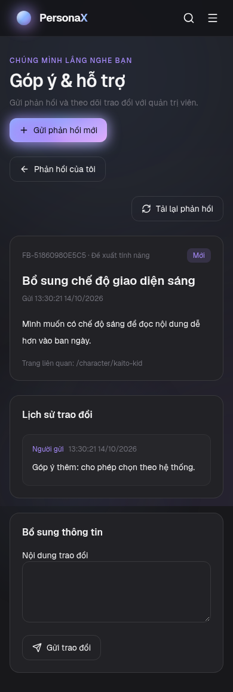

# Góp ý & hỗ trợ — đợt 1

Người dùng gửi báo lỗi, đề xuất tính năng hoặc góp ý khác tại `/feedback`.
Mỗi phản hồi có mã riêng, lịch sử trao đổi và trạng thái xử lý. Danh sách cá nhân
đánh dấu cập nhật công khai chưa đọc. Người dùng chỉ truy cập phản hồi của mình.

Admin/owner mở `/admin?tab=feedback` để tìm kiếm, lọc, phân trang, phân công,
đặt ưu tiên, trả lời và cập nhật trạng thái. Ghi chú nội bộ được phân biệt bằng
màu vàng và chỉ xuất hiện trong hộp thư quản trị. Moderator không có quyền truy cập.

Hai ảnh dưới đây được chụp từ browser tests với tài khoản và nội dung kiểm thử.
Đây là dữ liệu minh họa, không phải phản hồi thực tế của người dùng.

## Hộp thư quản trị trên desktop

## Trao đổi với người dùng trên mobile

## Kiểm thử thủ công

1. Đăng nhập bằng tài khoản người dùng; mở **Góp ý & hỗ trợ**, gửi phản hồi mới.
2. Đăng nhập admin/owner trong phiên trình duyệt khác; mở **Phản hồi người dùng**.
3. Tìm phản hồi, phân công và chuyển sang **Đang xem xét**; nhập lời giải thích.
4. Thêm ghi chú nội bộ. Ở phiên người dùng, tải lại và xác nhận chỉ thấy lời
   giải thích công khai; ghi chú nội bộ không xuất hiện.
5. Người dùng bổ sung thông tin. Admin tải lại, chuyển sang **Đã giải quyết**
   và nhập lời giải thích. Người dùng xem kết quả; form bổ sung được thay bằng
   hướng dẫn gửi phản hồi mới nếu cần hỗ trợ thêm.

Trước khi triển khai, chạy `alembic upgrade head` trong backend. Migration
`b7c23a90d416` tạo hai bảng hỗ trợ mới. Đính kèm ảnh và email sẽ được làm ở đợt sau.
